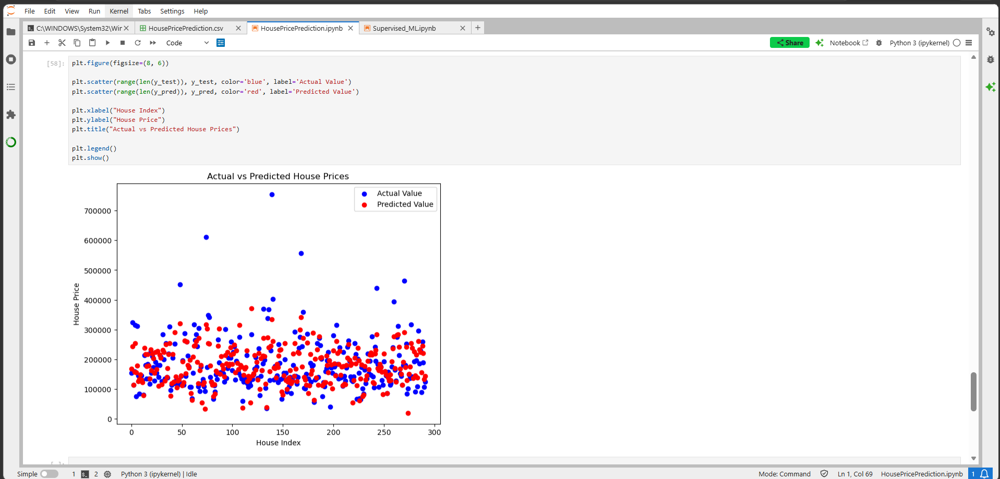

# 🏠 House Price Prediction using Linear Regression

A Machine Learning project that predicts house prices using **Linear Regression**.

## 📌 Project Overview

The objective of this project is to predict house prices based on different property-related features.

## 🛠️ Technologies Used

* Python
* Pandas
* NumPy
* Matplotlib
* Scikit-learn
* Jupyter Notebook

## 🔍 Steps Performed

1. Loaded the dataset
2. Analysed the dataset
3. Checked and handled missing values
4. Separated features and target variable
5. Converted categorical variables using One-Hot Encoding
6. Split the data into training and testing sets
7. Trained a Linear Regression model
8. Predicted house prices
9. Evaluated the model using R² and Adjusted R²
10. Visualized Actual vs Predicted prices

## 📊 Model Evaluation

The model was evaluated using:

* R² Score
* Adjusted R² Score
* Actual vs Predicted visualization

## 📈 Visualization

Actual vs Predicted House Prices

The scatter plot below shows the comparison between actual and predicted house prices using Linear Regression.

## 🙏 Acknowledgement

Thanks to **Apna College and Shraddha Ma'am** for the guidance and learning resources that helped me understand the Machine Learning concepts used in this project.

## 👩‍💻 Author

**Tasneem Fatma**

MCA Student | Python | Machine Learning | Full Stack Development
